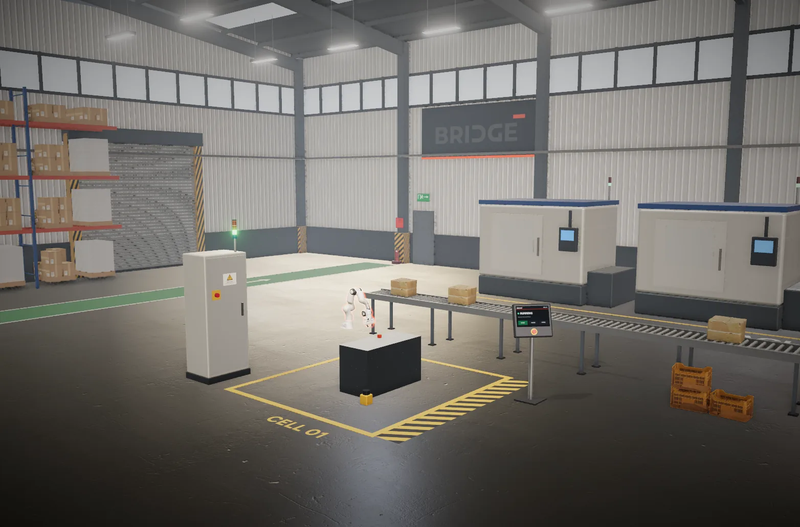
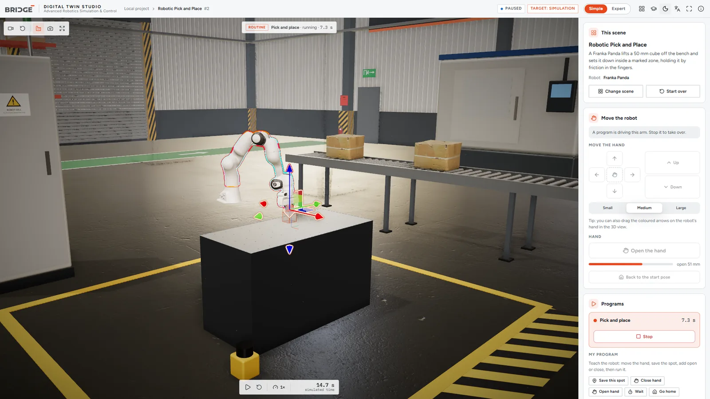
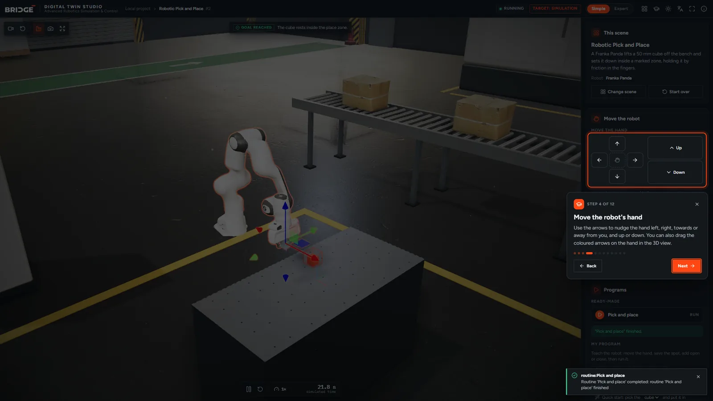
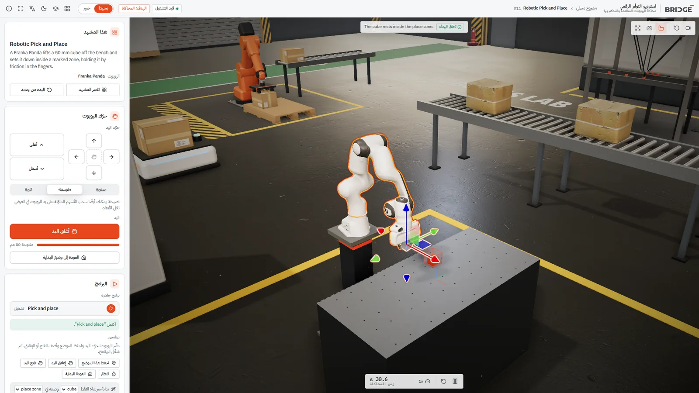
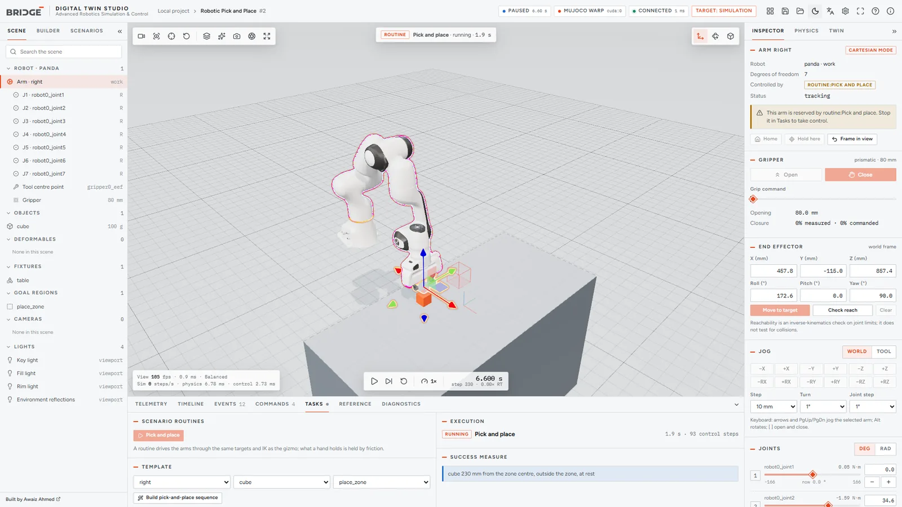
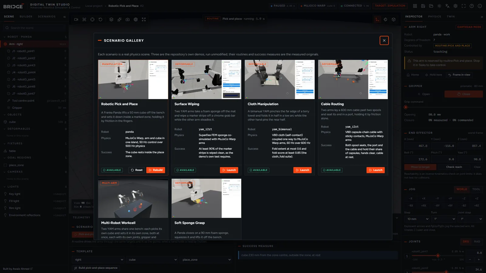
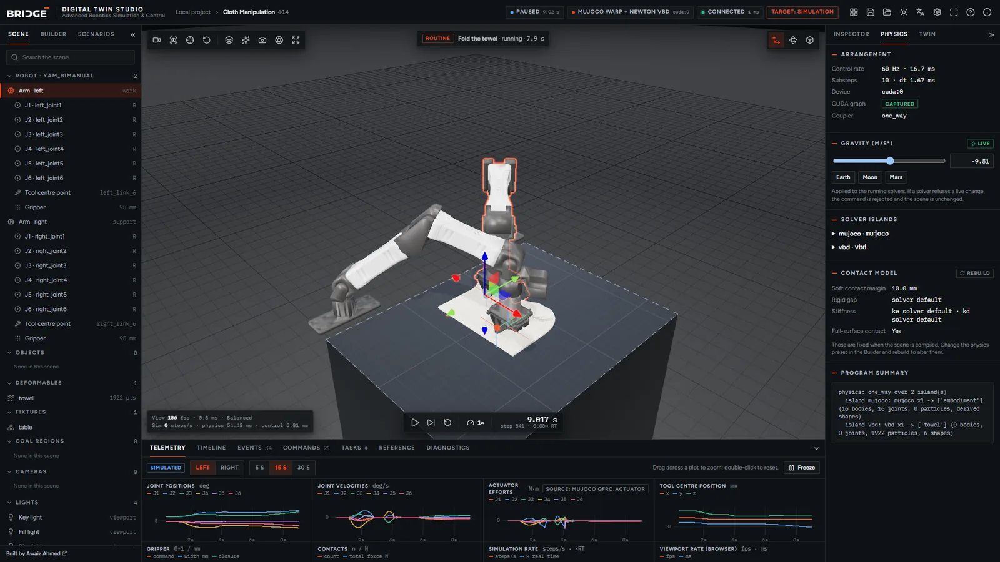
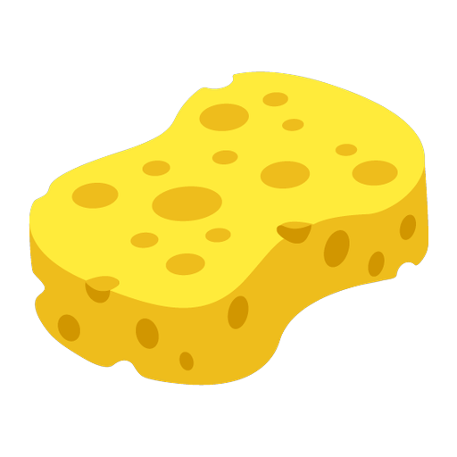
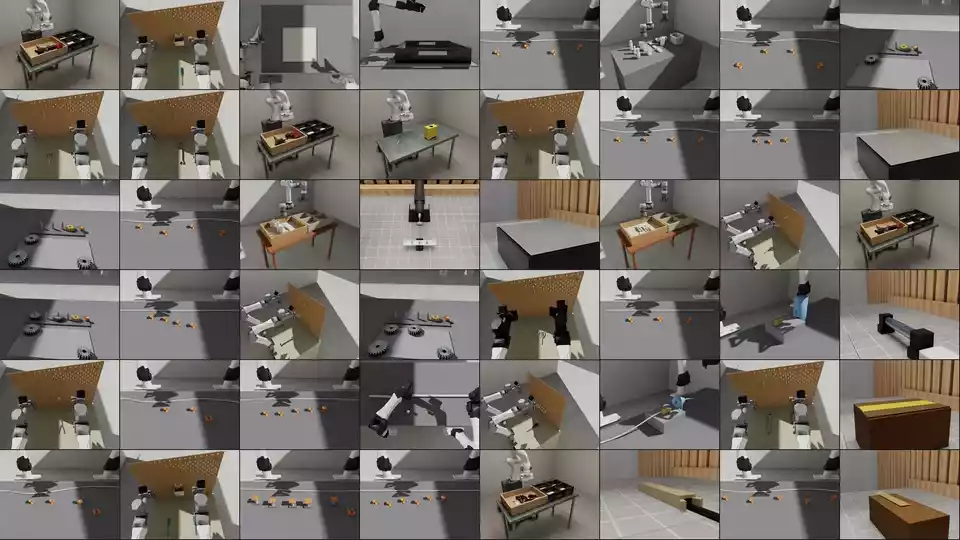

<p align="center">
  <picture>
    <source media="(prefers-color-scheme: dark)" srcset="light.png" />
    
  </picture>
</p>

<p align="center"><b>DIGITAL TWIN STUDIO</b> · Advanced Robotics Simulation &amp; Control</p>

<p align="center">
  Built by <a href="https://kanbanstudios.ae/team-kanban">Awaiz Ahmed</a>, on
  <a href="#robosimstudio">RoboSimStudio</a> (Apache-2.0)
</p>

<p align="center">
  
</p>

BRIDGE puts a GPU-simulated robot cell in a digital factory you can drive from a
browser. Move the robot with arrows, open and close its hand, run a ready-made
program or teach your own, and watch the physics do the rest. A Python service
owns the simulation (Newton, MuJoCo Warp, SuperDex) and streams it to the page;
the page draws what the simulator reports and sends commands back, each one
validated and acknowledged. The readings come from the simulator and are
labelled *Simulated*: a value a solver does not expose is shown as unavailable,
never made up.

<p align="center">
  <picture>
    <source media="(prefers-color-scheme: dark)" srcset="docs/bridge/media/factory-simple-dark.webp" />
    
  </picture>
</p>

## Start it

On Windows 10 or 11 with an NVIDIA GPU and a current driver, with
[uv](https://docs.astral.sh/uv/) installed, and Node.js 20+ for building the
browser client once:

```powershell
powershell -ExecutionPolicy Bypass -File scripts\bridge.ps1 -Doctor   # what this machine can run
powershell -ExecutionPolicy Bypass -File scripts\bridge.ps1 -Open     # serve http://127.0.0.1:8800 and open it
```

The first start installs the Python environment (several GB; a checkout inside
OneDrive keeps it in `%USERPROFILE%\.venvs\bridge-adroit`) and builds the
client. The first scene compiles its GPU kernels, which takes about two minutes;
they are cached after that, and a scene then builds in 5 to 70 seconds. Options:
`-Scenario cloth_fold`, `-Port 8801`, `-Paused`, `-Build` (rebuild the client),
`-NoSync` (skip syncing the Python environment). Ctrl+C stops the simulation and the
service.

The page opens in **Simple** mode with a one-minute guided tour (reopen it from
the graduation-cap button). **Expert** mode, one click away in the top bar, adds
every engineering panel. On a laptop with two GPUs, Windows may give the browser
the integrated one: the factory then runs at about 40 fps instead of 240. Pick
the browser under Settings, Display, Graphics, and set it to High performance.

The same service on Linux, where the upstream toolkit is developed (not tested
with BRIDGE yet):

```bash
uv sync --extra superdex
(cd frontend && npm ci && npm run build)
uv run python -m bridge_studio --open
```

## What it does

| | |
| --- | --- |
| **Digital factory** | The cell stands in a 36 x 26 m hall: an epoxy floor with painted walkways and the cell's boundary, a portal-frame roof with skylights and LED high-bays, pallet racking, a CNC machine line, a conveyor, a control cabinet whose stack light shows what the simulation is doing (green running, blue program, amber paused, red fault) and an operator panel that says it in words. Photo-scanned materials and props (Poly Haven, CC0) and image-based light; nothing in the hall is simulated, and a plain studio stage is one click away. |
| **Simple mode** | One panel in plain words: the scene in a sentence, the robot's hand moved with arrows (left, right, towards and away from you, up and down, as the camera sees it), a big Open/Close button, ready-made programs, and a goal that turns green when it is met. |
| **Teach a program** | Move the hand, press *Save this spot*, add *Close hand*, *Wait*, *Go home*, then *Run my program*; or let *Quick start* build a pick-and-place. Programs run on the service as tasks, step by step, and can repeat. |
| **Guided tour** | Twelve steps that light up each control and say what it does, in English or Arabic; it opens on a first visit. |
| **Viewport** | A three.js view built from the compiled model, with PBR materials and shadows: orbit, pan, zoom, view presets, perspective or orthographic, follow and focus, selection outlines, a transform gizmo, screenshots. Performance, Balanced and Ultra profiles, with the measured frame time on screen. |
| **Robot control** | Joint sliders with each joint's limits and units; an end-effector gizmo solved by inverse kinematics, with a reachability check that reports the residual; gripper open and close, read back as the measured opening; keyboard and button jogging at a chosen step, and a gamepad where one is connected (not yet tried with a real pad). Each command is answered *accepted*, *rejected* (with the reason), *completed*, *failed* or *interrupted*. |
| **Simulation** | Play, pause, single control step, reset, speed from 0.1x to as fast as the GPU goes. The step rate, real-time factor and per-step physics and control cost are measured, not estimated. |
| **Scenarios** | Six built-in scenes, each with a routine and a success measure evaluated on the simulation (below). |
| **Workcell builder** | Add, duplicate, move, rotate, resize and remove objects; set mass, friction, colour and cloth material; undo and redo; save and load versioned JSON documents. A document the chosen physics preset cannot simulate is refused before anything is built. |
| **Tasks** | Mission sequences of move, grip and wait steps aimed at objects, regions or offsets, run by the service. The arms a task drives are reserved until it ends. |
| **Engineering panels** | Telemetry plots (joint position, velocity and actuator effort, end effector, gripper, contacts, step rate), a timeline, the event log, the command history, diagnostics, a physics inspector (solver islands, contact model, live gravity) and debug overlays (collision geometry, link frames, target against actual tool pose, contact points and forces, centres of mass, goal regions). |
| **Real to sim** | Import a clip or a photo of the real cell, extract stills, path-trace the simulation from a matching camera and compare the two, with measured size, offset and overlap. |
| **Automation** | Everything the page does is an HTTP or WebSocket command an agent can send: [docs/bridge/AGENT_API.md](docs/bridge/AGENT_API.md), and the OpenAPI reference at `/docs` on the running service. |
| **Interface** | Dark and light themes, English and Arabic (right to left), keyboard shortcuts, from 1366x768 up. |

<p align="center">
  
  
</p>

<p align="center">
  <picture>
    <source media="(prefers-color-scheme: dark)" srcset="docs/bridge/media/studio-dark.webp" />
    
  </picture>
  
</p>

### Scenarios

| Scenario | Robot | Physics | Succeeds when |
| --- | --- | --- | --- |
| Robotic Pick and Place | Franka Panda | MuJoCo Warp, rigid grasp | the cube rests inside the place zone |
| Multi-Robot Workcell | two YAM arms | MuJoCo Warp, rigid grasp | each arm's cube rests inside its own zone |
| Soft Sponge Grasp | Franka Panda | SuperDex FEM foam beside MuJoCo Warp | the sponge's underside is lifted 30 mm |
| Cloth Manipulation | two YAM arms | VBD cloth coupled one way to MuJoCo Warp | the towel is folded (extent at most 0.6, score at least 0.85) |
| Cable Routing | two YAM arms | VBD capsule-chain cable | both spool seats, the port and the cable end hold, hands clear |
| Surface Wiping | two YAM arms | SuperDex FEM sponge beside MuJoCo Warp | at least 90 % of the marker stripe is wiped clean |

The last three are the repository's own demos (`examples/08_demos`), run
unmodified. On the development machine (Windows 11, RTX 5080 Laptop GPU,
2026-10-16) each routine ran through the service and met its measure. Measured
there: pick and place and the sponge keep up with real time, the cable runs at
about 0.8x and the wiping at about 0.7x, and the cloth at 0.1-0.3x (about 48 ms
of physics per 60 Hz control step with the towel flat, more as it folds onto
itself).

<p align="center">
  
</p>

## What it is not

- **Simulation only.** No robot hardware is connected or supported yet. The
  hardware connector is an interface that stays disconnected, and the hardware
  mode is locked behind interlocks none of which is met. The Pause and Stop
  controls act on the simulation; they are not an emergency stop for any machine.
- **Not measured from a real robot.** Telemetry is simulated. Effort is MuJoCo's
  actuator force where the solver exposes it, contacts are the solver's contact
  table, and nothing is filled in where a solver is silent.
- **The factory is scenery.** Its machines, conveyor and racking are not
  simulated and do not move; only the cell's stack light and operator panel
  follow the simulation's state. The red button on that panel is part of the
  scenery, not a control.
- A path-traced snapshot holds the simulation while it renders: about two
  minutes the first time (the renderer compiles), seconds after that.
- One robot embodiment per scene, as in RoboSimStudio; the two-armed YAM cells
  are one embodiment with two arms.

## Checks

```bash
uv run python scripts/testrun.py --tier fast                 # no GPU
uv run --extra gap python scripts/testrun.py --tier medium   # builds and steps scenes on the GPU
uv run --group media python -m unittest tests.test_bridge_journey   # the 18-step journey in Edge or Chrome
uv run --group media python -m unittest tests.test_bridge_simple    # Simple mode, the tour, a taught program
cd frontend && npm test                                      # the client's frame decoder and dictionaries
```

BRIDGE's own tests are `tests/test_bridge_fast.py` (no GPU),
`tests/test_bridge_host.py` (the service on a real scene),
`tests/test_bridge_journey.py` (the engineering panels in a browser) and
`tests/test_bridge_simple.py` (Simple mode, the tour and a taught program in a
browser). On Windows,
88 of the upstream fast-tier tests fail the same way on an unmodified upstream
checkout: they assume POSIX path separators, a UTF-8 default encoding, or Unix
sockets and process groups.

## Documentation

- [Architecture](docs/bridge/ARCHITECTURE.md): how the service, the page and the simulator fit together, and why.
- [Agent and automation API](docs/bridge/AGENT_API.md): every endpoint and command, with an example session.
- [Plan](docs/bridge/PLAN.md): the milestones as built.

## Licence and credits

BRIDGE's additions (`bridge_studio/`, `frontend/`, `docs/bridge/`,
`scripts/bridge.ps1`) are released under the [Apache License 2.0](LICENSE), as
RoboSimStudio is. Third-party robot models keep their own licences, listed in
[`NOTICE`](NOTICE); the page lists them too, under About, Open-source licences.
The factory's HDRI, scanned textures and props are from
[Poly Haven](https://polyhaven.com) under CC0, listed with what was done to each
in [`frontend/public/factory/ASSETS.md`](frontend/public/factory/ASSETS.md).

---

<a id="robosimstudio"></a>

#  RoboSimStudio

[Tech report](https://arxiv.org/abs/2610.18835) | [Project Page](https://robosimstudio.github.io/)

RoboSimStudio is an open, interactive GPU simulation toolkit for rebuilding real
robot manipulation tasks in simulation, by hand or with a coding agent.

<p align="center">
  
</p>

## Quick start

We provide comprehensive examples in [`examples/`](https://github.com/robosimstudio/robosimstudio/tree/main/examples) to help you get started quickly. Alternatively, you can use a coding agent such as Codex or Claude Code to create a simulation environment by simply providing the following prompt:

```
Set up environment for https://github.com/robosimstudio/robosimstudio
and create a simulation environment for [Your task instruction]
based on the video at [Your Video Path].
```

## Acknowledgements

RoboSimStudio is built on [Newton](https://github.com/newton-physics/newton),
[Warp](https://github.com/NVIDIA/warp) and
[MuJoCo Warp](https://github.com/google-deepmind/mujoco_warp), and its studio
on [viser](https://github.com/viser-project/viser). It draws on
[Isaac Lab](https://github.com/isaac-sim/IsaacLab),
[Isaac Lab Arena](https://github.com/isaac-sim/IsaacLab-Arena),
[PyRoKi](https://github.com/chungmin99/pyroki),
[Genesis](https://github.com/Genesis-Embodied-AI/Genesis),
[SuperDex](https://github.com/facebookresearch/project_superdex) and
[LeRobot](https://github.com/huggingface/lerobot). Robot models come from
[i2rt](https://github.com/i2rt-robotics/i2rt) and
[robosuite](https://github.com/ARISE-Initiative/robosuite); see `NOTICE`.
Thanks to their authors.

## Citation

```bibtex
@misc{robosimstudio2026,
  title         = {RoboSimStudio: An Interactive Toolkit for Rapid Real2Sim of Robot Manipulation Tasks},
  author        = {Chen, Kaiyuan and Xie, Shuangyu and Yoo, Uksang and Zhu, Xinyue and Magner, Cael and Zhu, Alvin and Kim, Daehwa and Heiden, Eric and Coumans, Erwin and Macklin, Miles and Huang, Spencer and Goldberg, Ken},
  year          = {2026},
  eprint        = {2610.18835},
  archivePrefix = {arXiv},
  url           = {https://arxiv.org/abs/2610.18835},
}
```

## License

RoboSimStudio is released under the [Apache License 2.0](LICENSE).
